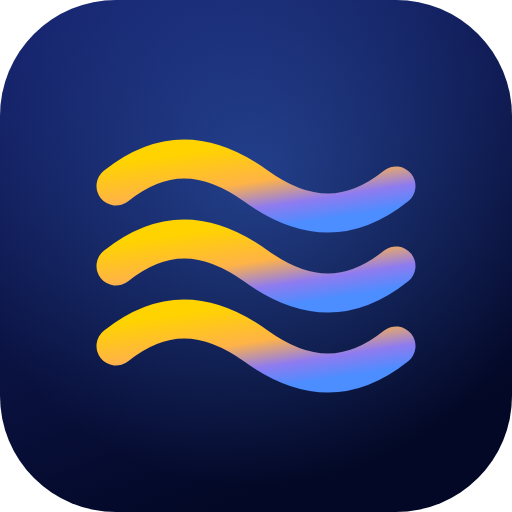
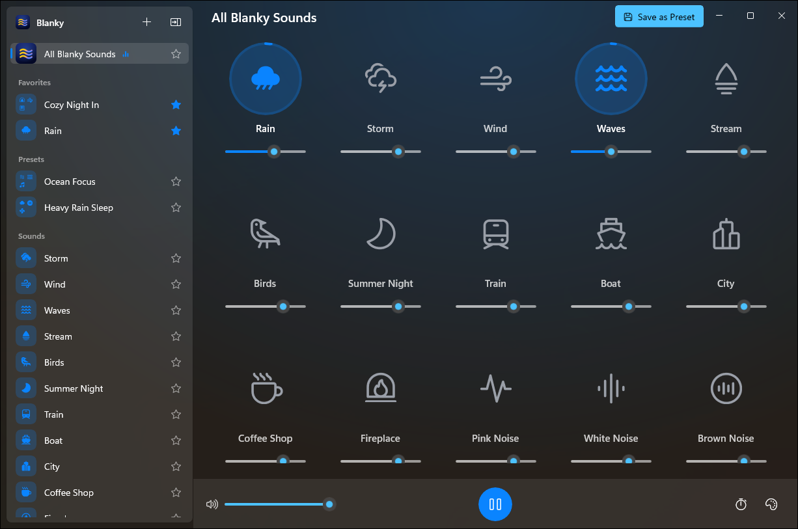

<div align="center">
  

# Blanky

Ambient sound mixer for Windows

<p>
  
  
  
  <a href="LICENSE"></a>
  <a href="https://github.com/baala3/Blanky/actions/workflows/ci.yml"></a>
</p>

<p><a href="https://github.com/baala3/Blanky/releases/latest"><b>Download for Windows</b></a> · <a href="https://baala3.github.io/Blanky/">Website</a> · <a href="https://baala3.github.io/Blanky/faq/">FAQ</a></p>


</div>

## About

Blanky helps you focus, wind down and sleep better by mixing ambient sounds.
Layer rain, waves, a fireplace, a fan, coffee-shop chatter or noise colors, each at its own volume, until the mix feels right.

It's the Windows member of a small family of free, open-source mixers: [Blanket](https://github.com/rafaelmardojai/blanket) started it on Linux, [Blankie](https://github.com/codybrom/Blankie) brought it to Mac, iPhone and iPad, and Blanky brings the same sounds and design to Windows.

## Features

- **24 high-quality ambient sounds**, from rain and waves to brown noise and lo-fi beats
- **Mix multiple sounds** with individual volume controls and endless loops
- **Presets** that save automatically, with per-preset accent colors and favorites
- **Import your own sounds** (M4A, MP3, WAV, FLAC, AAC, WMA), loudness-matched to the built-ins
- **Share presets** as `.blanky` files, and open `.blankie` presets made on a Mac
- **Sleep timer** that pauses your mix and lets your PC go to sleep
- **Single-sound mode and Quick Mix** for fast listening
- **Native Windows 11 look** with Mica, light and dark themes and your Windows accent color
- **Keyboard shortcuts**: Space, Ctrl+↑/↓ for volume, Ctrl+→/← for favorites
- **Private and offline**: no account, no analytics, no network access

## Install

1. Download the zip for your PC from the [latest release](https://github.com/baala3/Blanky/releases/latest) (`x64` for most PCs, `arm64` for Snapdragon PCs).
2. Extract it somewhere permanent, for example `%LOCALAPPDATA%\Programs\Blanky`.
3. Run `Blanky.exe`.

Releases aren't code-signed yet, so SmartScreen may warn on first launch; choose **More info**, then **Run anyway**.
Every release is built from this repository by GitHub Actions.

Requires Windows 11, or Windows 10 version 2004 or later.

## Development

You need the [.NET 10 SDK](https://dotnet.microsoft.com/download) on Windows.

```powershell
dotnet build Blanky.slnx -c Debug -p:Platform=x64
dotnet run --project src/Blanky -p:Platform=x64
```

Working from WSL? `scripts/win.sh build | test | run` mirrors the repo to the Windows drive and drives the Windows SDK from there.

| Path | What's there |
| --- | --- |
| `src/Blanky.Core` | Audio engine, playback rules, presets and storage. Platform-free and unit tested. |
| `src/Blanky` | The WinUI 3 app: windows, controls, Media Foundation decoding and WASAPI output. |
| `tests/Blanky.Core.Tests` | xUnit tests for the core. |
| `website` | The [website](https://baala3.github.io/Blanky/), built with Astro. |
| `scripts` | Icon generation, screenshots and WSL helpers. |

See [CONTRIBUTING.md](CONTRIBUTING.md) for more.

## Support

Blanky is free and always will be. If it helps you sleep or focus, you can support it:

- [Buy Me a Coffee](https://buymeacoffee.com/baala3)
- [GitHub Sponsors](https://github.com/sponsors/baala3)
- Star this repo, [report bugs](https://github.com/baala3/Blanky/issues) or contribute code

## License

- **Source code**: [MIT License](LICENSE). Portions are adapted from Blankie (MIT); see the license file.
- **Sounds and icons**: various open licenses; see [CREDITS.md](CREDITS.md).

Blanky is an independent project and isn't affiliated with Blankie or Blanket.

---

<div align="center">
  <sub>Inspired by <a href="https://github.com/codybrom/Blankie">Blankie</a> for Mac and <a href="https://github.com/rafaelmardojai/blanket">Blanket</a> for Linux</sub>
</div>
